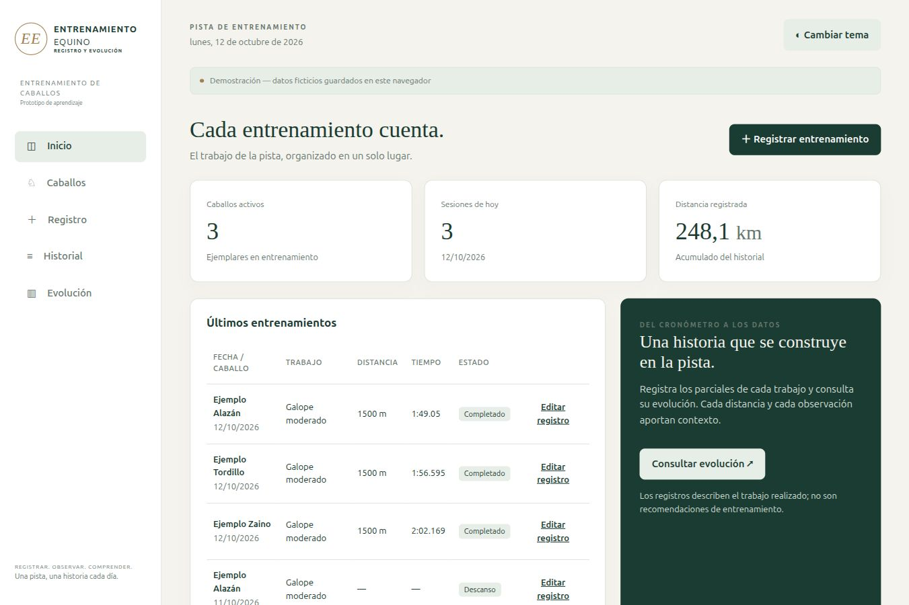
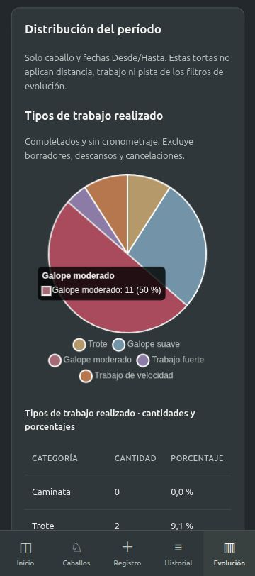

# Entrenamiento Equino

**[Abrir la demo](https://martnmartnez14.github.io/entrenamiento-equino/)** · [Roadmap](docs/roadmap.md) · [Guía de uso](docs/guia.md)

Un prototipo para registrar entrenamientos de caballos y consultar su evolución. Se puede probar sin instalar nada y sin crear una cuenta: la demo utiliza datos ficticios y guarda los cambios en el navegador.

Este proyecto se cerró como experiencia de aprendizaje en octubre de 2026. Queda disponible con licencia MIT para estudiar el código, adaptarlo o ampliarlo. No hay desarrollo activo ni fechas comprometidas para las ideas del roadmap.



## Probarlo en unos minutos

1. Abre la demo. Encontrarás tres caballos de ejemplo y entrenamientos ficticios de doce semanas.
2. En **Registro**, elige caballo, fecha, responsable y estado. Selecciona **Por tramo**, **Acumulados** o **Solo tiempo final**; completa distancia y tiempos.
3. Guarda el entrenamiento y búscalo en **Historial**. También puedes crear un caballo o editar una sesión.
4. En **Evolución**, elige caballo y fechas. Filtra sesiones de la misma distancia y trabajo; compara parciales equivalentes y consulta las distribuciones del período.
5. Usa **Exportar copia** para conservar un JSON. Importar o reiniciar solicita confirmación antes de reemplazar los datos.

**Los datos no se comparten entre personas o navegadores.** Borrar los datos del sitio puede eliminar los registros locales. La copia JSON no está cifrada: utiliza únicamente información ficticia en la demo pública.

## Qué permite hacer

- Crear y editar caballos, conservar el historial de los inactivos y buscar registros.
- Registrar completados, borradores, trabajos sin cronometraje, descansos y cancelaciones.
- Introducir tiempos por tramo, acumulados o solamente el tiempo final, con segundos decimales o formato `1:51`.
- Dividir distancias variables: 1200 m produce tramos de **500 + 500 + 200**. Los tiempos se guardan como milisegundos enteros.
- Consultar evolución de totales comparables, barras de parciales, resumen semanal y tortas de tipos de trabajo y estados.
- Mostrar valores en tablas, usar temas claro/oscuro y navegación adaptada a pantallas pequeñas.
- Exportar JSON versión 2 e importar versiones 1 y 2.

Los colores de las líneas indican dirección del tiempo: subida verde, bajada roja e igualdad gris. No califican rendimiento. Las tortas usan solo caballo y período; distancia, tipo y pista no las filtran. Los datos ausentes no se convierten en cero y los borradores no cuentan como trabajo realizado.

<details>
<summary>Vista móvil simulada</summary>



Es una captura del navegador a tamaño móvil; no acredita una prueba en teléfonos físicos.
</details>

## Dos versiones, dos formas de guardar

| Versión | Acceso | Almacenamiento |
|---|---|---|
| Demo pública / independiente | Sin cuenta | IndexedDB del navegador; cada persona tiene sus propios datos |
| Servidor Flask para prueba local | Cuentas individuales | SQLite compartida por quienes usan ese servidor |

GitHub Pages publica **solo la demo estática**. No ejecuta Python, no contiene una base deportiva central ni proporciona usuarios compartidos. El código del servidor se incluye en el repositorio para estudiar o ampliar el proyecto, pero no está desplegado online.

### Abrir la demo local

Requiere Python 3, sin instalar paquetes:

```bash
git clone https://github.com/MartnMartnez14/entrenamiento-equino.git
cd entrenamiento-equino
python3 demo_preview.py
```

Abre **http://localhost:8000/**. No uses un servidor genérico sobre toda la carpeta si preparaste el backend: podría exponer archivos privados. La vista previa incluida permite únicamente los archivos públicos necesarios.

### Preparar el servidor local

Requiere Python 3.12 y las dependencias de `requirements.txt`. En Linux/macOS:

```bash
python3 -m venv .venv
.venv/bin/python -m pip install -r requirements.txt
.venv/bin/python manage.py migrate
.venv/bin/python manage.py create-admin
.venv/bin/python manage.py seed-demo
.venv/bin/python manage.py serve --port 8001
```

En Windows utiliza `.venv\Scripts\python.exe` en lugar de `.venv/bin/python`. Abre **http://localhost:8001/**. `create-admin` solicita una contraseña de 12–128 caracteres mediante entrada segura; no existen credenciales predeterminadas. `seed-demo` es opcional y carga ejemplos solo en una base deportiva vacía.

La base se crea en `instance/entrenamiento-equino.sqlite`. `DATABASE_URL` permite elegir otra ubicación. `.env.example` explica la configuración, pero no se carga automáticamente. La demo genérica usa un espacio propio de IndexedDB y no borra almacenes anteriores.

## Cuentas y permisos del servidor

| Capacidad | Administrador | Trabajador |
|---|---|---|
| Consultar caballos, historial y comparativas | Sí | Sí |
| Registrar entrenamientos | Sí | Sí |
| Corregir entrenamientos | Cualquiera | Los propios, sin límite de tiempo |
| Crear y editar caballos | Sí | No |
| Gestionar cuentas | Sí | No |
| Consultar auditoría e importar/exportar copias deportivas | Sí | No |

El **autor** es quien guarda con su cuenta; el **responsable del trabajo** es un dato separado. Las correcciones dejan auditoría. El servidor controla permisos, versiones de edición, claves de operación para evitar duplicados, CSRF, sesiones de ocho horas y límites de intentos de login. Las contraseñas se almacenan con hash y las sesiones se invalidan al restablecerlas o desactivar una cuenta.

La demo sin cuentas no tiene esta separación de roles. Los respaldos completos del servidor se hacen mediante comandos, no con la exportación deportiva de la interfaz.

## Respaldar y restaurar una base local

```bash
.venv/bin/python manage.py backup instance/backups/mi-copia.sqlite
```

El comando usa la API de backup de SQLite y verifica integridad y relaciones. Genera un manifiesto y no sobrescribe copias existentes. Para restaurar, detén el servidor y ejecuta:

```bash
.venv/bin/python manage.py restore instance/backups/mi-copia.sqlite --confirm
```

La restauración conserva una copia previa e invalida las sesiones. Estas copias incluyen información privada: no las subas a GitHub. No hay respaldos automáticos, cifrados ni externos configurados. El JSON deportivo no incluye cuentas ni auditoría y no sustituye un respaldo completo.

## Código y pruebas

HTML, CSS y JavaScript modular; Chart.js 4.4.8 servido localmente; Flask, SQLAlchemy y Alembic. No requiere compilación del frontend ni paquetes npm para usarlo.

```bash
.venv/bin/python -m pytest -q tests
node --test tests/*.test.js
python3 scripts/build_site.py
```

Node se utiliza solo para las pruebas. El generador crea `_site/` desde una lista explícita de archivos estáticos; GitHub Actions ejecuta las pruebas antes de desplegar esa carpeta en Pages. No publica la raíz completa del repositorio.

Lee [arquitectura y despliegue futuro](docs/arquitectura.md), [API](docs/api.md) y [validación](docs/validacion.md). Las propuestas pendientes están en el [roadmap](docs/roadmap.md).

## Alcance

Prototipo descriptivo con ejemplos ficticios. No prescribe cargas, no interpreta clínicamente los resultados y no analiza fotos o videos. No tiene agenda, cronómetro integrado, comparación entre caballos, multimedia ni sincronización offline con el servidor.

La presentación móvil fue revisada en tamaños simulados. Teléfonos físicos, Safari/iOS y lectores de pantalla siguen pendientes de ensayo. El servidor de desarrollo escucha en localhost y no debe utilizarse para producción. Un despliegue futuro necesita hosting WSGI, HTTPS, configuración operativa y respaldos externos; no se contrató ningún servicio.

## Licencia

MIT — Martín Martínez García. Puedes reutilizar y modificar el código manteniendo el aviso de licencia. Chart.js conserva su licencia y avisos propios en `vendor/`.
